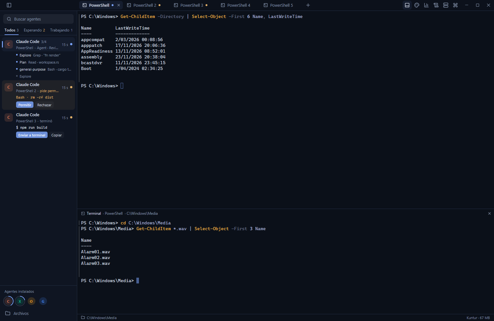
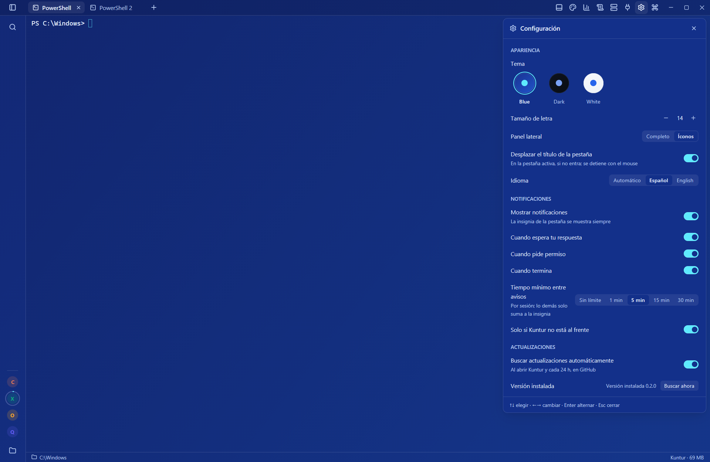
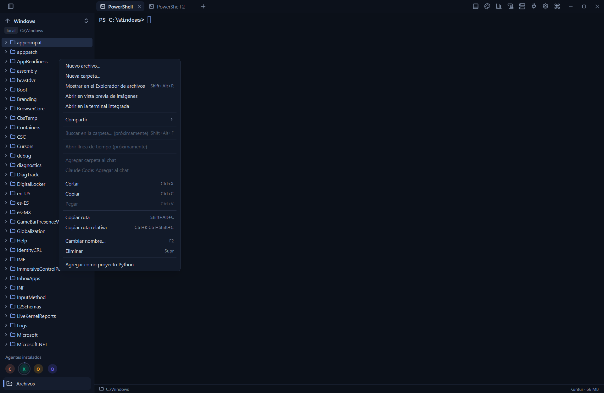
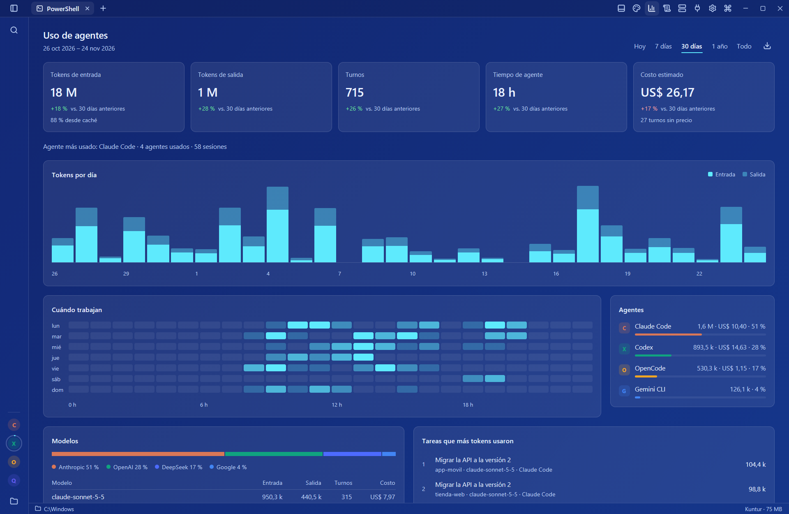
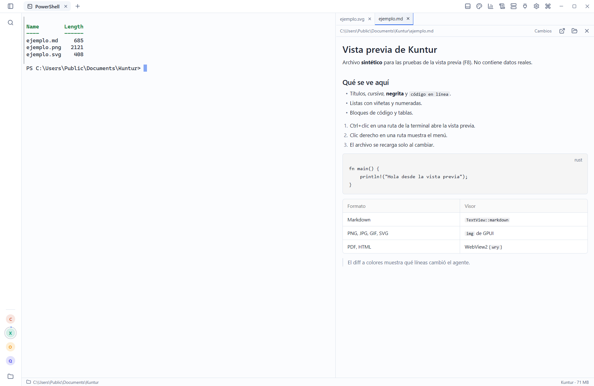

# Kuntur Terminal IA Agente

[English](README.md) · **Español**

> **Estado: versión preliminar (0.2).** Se puede usar a diario en Windows 11, pero todavía tiene asperezas.
> Los comentarios son bienvenidos.

[-2f81f7?style=for-the-badge&logo=windows)](https://github.com/jrsprescott/kuntur/releases/latest)
[](https://github.com/jrsprescott/kuntur/releases/latest)

**[⬇ Descargar la última versión](https://github.com/jrsprescott/kuntur/releases/latest)** — abre la página y descarga `kuntur-<versión>-x86_64.msi` en *Assets*.
¿Ya lo tienes instalado? Kuntur avisa cuando sale una versión nueva y se actualiza con un clic.

**Kuntur Terminal IA Agente** — *Kuntur* significa cóndor en quechua — es una terminal liviana para Windows, escrita en Rust, pensada para trabajar con
agentes de IA en la línea de comandos (Claude Code, Codex, OpenCode, Qwen, Gemini…). Como el cóndor que ve todo el
valle desde lo alto, ves de un vistazo todas tus sesiones y lo que hace cada agente en este momento.



- **Liviana:** unos **60–80 MB de RAM** con una ventana y menos de **120 MB** con cinco sesiones y varios agentes
  (Warp usa ~900 MB en el mismo equipo). Dibujo nativo por GPU con [GPUI](https://www.gpui.rs/).
- **Privada por diseño:** todo corre en tu PC. Sin cuenta, sin telemetría; su única conexión de red propia es buscar
  actualizaciones en GitHub (se puede apagar).

## Funciones

- **Terminal real:** ConPTY + `alacritty_terminal` (colores, truecolor, mouse, pantalla alterna, pegado entre
  corchetes, portapapeles OSC 52); Ctrl+C inteligente (copia si hay selección), Ctrl+V, pegar con clic derecho.
- **Sesiones como pestañas**, que se guardan y restauran; panel lateral completo o solo íconos; tres temas
  (**Blue**, **Dark**, **White**) desde `themes/*.toml`; paleta de comandos (Ctrl+Shift+P).
- **Panel de agentes:** agentes y subagentes en un árbol compacto con su acción actual y su estado exacto
  (trabajando / pide permiso / espera tu respuesta / terminó) gracias a los hooks de Claude Code (`kuntur-hook.exe`,
  un named pipe y OSC 7501). Permitir o rechazar desde la fila, un worktree de git por agente, "Enviar a terminal"
  para los comandos sugeridos.
- **Terminal acoplada** (Ctrl+`) debajo de cada sesión, en su carpeta o en el worktree del agente.
- **Alertas:** insignia en la pestaña y notificación de Windows cuando un agente de una pestaña oculta termina o te
  necesita.
- **Uso de agentes:** tokens por día, mapa de horas, modelos, tareas principales y **costo estimado** (`pricing.toml`
  editable), para Hoy / 7 días / 30 días (solo se cargan los últimos 30 días), con exportación a CSV; un clic en una
  tarea reanuda ese chat en una pestaña nueva. Se lee de forma incremental de los registros locales de cada agente a
  un almacén SQLite local.
- **Auditoría:** cada comando que ejecutó un agente en los últimos 30 días (fecha, agente, chat, carpeta, comando),
  con búsqueda, filtros y CSV.
- **SSH y SFTP** (`russh`): conexiones guardadas, verificación de `known_hosts`, ssh-agent de Windows, contraseñas
  solo en el Administrador de credenciales de Windows; pestañas remotas con terminal acoplada por la misma conexión;
  árbol de archivos remoto con subida (arrastrar desde el Explorador), descarga y cola de transferencias. Lo local y
  lo remoto nunca se mezclan.
- **Vista previa y diff:** las rutas y URLs de la salida se pueden abrir; Markdown, imágenes, SVG, diff a colores,
  PDF y HTML (WebView2) en una vista dividida que se recarga sola.
- **Integración con el shell:** bloques OSC 133 (una marca fina por comando, roja si falló) y **autocompletado en
  gris** de rutas, memoria de carpetas e historial por carpeta (Tab o → aceptan).
- **Capturas para tu agente, como en Warp:** Ctrl+V con una imagen en el portapapeles la adjunta — Claude Code
  muestra `[Image #N]`, los demás agentes reciben la ruta del PNG guardado y las pestañas SSH primero la suben —, y
  una barra del agente muestra las miniaturas.
- **La pestaña dice qué hace el agente:** el título que pone el agente (en Claude Code, el tema de la conversación)
  reemplaza a "PowerShell"; si es largo, en la pestaña activa se desplaza y se detiene con el mouse.
- **Árbol de archivos como el Explorer de VS Code**, con su menú de clic derecho (nuevo archivo/carpeta, cambiar
  nombre, eliminar a la Papelera, cortar/copiar/pegar entre local y remoto, copiar ruta, mostrar en el Explorador,
  agregar al chat…).
- **Configuración** (Ctrl+,): temas, tamaño de letra, idioma (español / inglés), notificaciones que no molestan
  (por tipo, como mucho una por sesión cada pocos minutos y solo en segundo plano) y búsqueda de actualizaciones.
- **IA local:** detecta LM Studio y Ollama (y Jan, llama.cpp), muestra sus modelos y abre **OpenCode con un modelo
  local** con un clic: un agente que corre 100 % en tu PC, sin nube y sin costo.
- **Actualizar con un clic:** un aviso cuando sale una versión nueva; Kuntur descarga el instalador, verifica su
  SHA-256 y su firma, lo instala y se vuelve a abrir.

| Configuración (Blue) | Archivos y menú contextual (Dark) |
|---|---|
|  |  |

| Uso (Blue) | Vista previa (White) |
|---|---|
|  |  |

## Instalar

Descarga `kuntur-<versión>-x86_64.msi` de la [última versión](https://github.com/jrsprescott/kuntur/releases/latest) y ejecútalo. Instala `kuntur.exe` y
`kuntur-hook.exe` en `C:\Program Files\Kuntur` y agrega **Kuntur** al menú Inicio y al escritorio. Se desinstala desde
*Configuración → Aplicaciones*; tu configuración en `%APPDATA%\Kuntur` se conserva.

**Firma de código:** las versiones para Windows **todavía no están firmadas**, así que SmartScreen puede mostrar
"Editor desconocido" (*Más información → Ejecutar de todas formas*). La nota de cada versión trae el SHA-256 del
instalador, y el actualizador de la app lo verifica antes de instalar. El proceso de firma queda listo para cuando
haya un certificado; ver [CODE_SIGNING_POLICY.md](CODE_SIGNING_POLICY.md) (política de firma y de privacidad).

Requisitos: Windows 11 x64 (probado; Windows 10 1809+ debería funcionar porque tiene ConPTY), GPU con DirectX 11/12.
Fuente recomendada: Cascadia Mono (viene con Windows 11). La vista previa de PDF/HTML usa WebView2, que trae Windows.

## Compilar desde el código

Requisitos: Rust estable (1.90+) y Visual Studio Build Tools con "Desarrollo de escritorio con C++" (MSVC + Windows SDK).

```powershell
git clone https://github.com/jrsprescott/kuntur.git
cd kuntur
cargo build -p kuntur-app -p kuntur-hook --release
.\target\release\kuntur.exe
```

La primera compilación tarda varios minutos (GPUI y SQLite). Para generar el MSI hacen falta además WiX Toolset
v3.14 y `cargo install cargo-wix`; luego `.\scripts\msi.ps1` (ver [CONTRIBUTING.md](CONTRIBUTING.md)).

### Estructura
```
kuntur/
├── crates/
│   ├── kuntur-app/        binario `kuntur`: ventana y UI (GPUI + gpui-kit); wix/ = instalador
│   ├── kuntur-term/       PTY (ConPTY / transporte SSH) + parser VT (alacritty_terminal)
│   ├── kuntur-agents/     catálogo de agentes, árbol de procesos, worktrees
│   ├── kuntur-hook/       `kuntur-hook.exe`: hooks de Claude Code → named pipe
│   ├── kuntur-usage/      uso, costos y límites (Claude Code, Codex, OpenCode)
│   ├── kuntur-audit/      auditoría de comandos
│   ├── kuntur-ssh/        SSH y SFTP (russh)
│   ├── kuntur-files/      árbol de archivos local / SFTP / WSL y transferencias
│   ├── kuntur-preview/    vista previa y diff
│   ├── kuntur-complete/   autocompletado y memoria de carpetas
│   └── kuntur-config/     configuración, temas y conexiones
├── themes/                blue.toml · dark.toml · white.toml
├── assets/                ícono
├── scripts/               smoke.ps1 (prueba de humo), msi.ps1 (instalador)
└── docs/                  plan, especificación, planes y resultados de cada fase
```

## Atajos de teclado

| Atajo | Acción |
|---|---|
| Ctrl+Shift+P | Paleta de comandos (temas, sesiones, acciones) |
| Ctrl+, | Configuración (temas, idioma, notificaciones, actualizaciones) |
| Ctrl+Shift+T / Ctrl+Shift+W | Nueva sesión / cerrar sesión |
| Ctrl+Tab, Ctrl+Shift+Tab, Ctrl+1…9 | Cambiar de sesión |
| Ctrl+Shift+B | Panel lateral: completo ↔ íconos |
| Ctrl+Shift+E | Panel Archivos (local o remoto según la pestaña) |
| Ctrl+` (Ctrl+Ñ en teclados en español) | Mostrar/ocultar la terminal acoplada |
| Ctrl+Shift+U | Uso de agentes (← → período, Ctrl+S exportar CSV) |
| Ctrl+Shift+A | Auditoría (escribir = buscar, ← → período, ↑ ↓ agente, Ctrl+S exportar CSV) |
| Ctrl+Shift+O | Conexiones SSH (↑ ↓ elegir, Enter conectar, F2 editar, Supr borrar, Ctrl+N nueva) |
| Ctrl+Shift+R | Reconectar una pestaña remota |
| Ctrl+= / Ctrl+− / Ctrl+0 | Tamaño de letra |
| Ctrl+clic / clic derecho sobre un enlace | Abrir / menú del enlace |
| Tab o → | Aceptar la sugerencia en gris |
| Esc | Cierra lo que esté encima (paleta, panel, menú); si no hay nada, va al shell |

## Privacidad

- Kuntur **no tiene telemetría**. Su **única conexión de red propia** es buscar actualizaciones: al abrirse y cada
  24 h consulta la API pública de GitHub (User-Agent `Kuntur/<versión>`, sin datos tuyos) y, solo si pulsas
  "Actualizar", descarga el instalador y verifica su SHA-256 y su firma. Se apaga en Configuración → Actualizaciones
  (`buscar_actualizaciones = false`). Las demás conexiones son las sesiones SSH
  que abras y lo que hagan los programas que ejecutes dentro de la terminal (un HTML en la vista previa puede cargar
  lo que referencia, como en cualquier navegador; los enlaces se abren en tu navegador).
- El uso, los costos y la auditoría se calculan **en tu PC** a partir de los registros de los agentes; nada sale de ella.
- Las contraseñas SSH se guardan solo en el Administrador de credenciales de Windows, y solo si marcas "recordar".
- Los hooks de Claude Code se instalan solo después de que confirmes, y solo agregan entradas que apuntan a
  `kuntur-hook.exe`.

## Accesibilidad

Todos los paneles se manejan con el teclado, Esc funciona igual en todas partes, el tamaño de letra se ajusta y los
tres temas cumplen el contraste WCAG AA (lo comprueba una prueba). Los lectores de pantalla **todavía no** funcionan:
GPUI no expone un árbol de accesibilidad (UI Automation) en Windows.

## Contribuir y seguridad

Ver [CONTRIBUTING.md](CONTRIBUTING.md) y [SECURITY.md](SECURITY.md). Los cambios están en [CHANGELOG.md](CHANGELOG.md).
La documentación del proyecto está en [`docs/`](docs/), empezando por [`docs/plans/README.md`](docs/plans/README.md).

## Licencia

Con licencia [Apache License, Version 2.0](LICENSE-APACHE) o [MIT](LICENSE-MIT), a tu elección. Salvo que indiques lo
contrario, toda contribución que envíes para incluirla en Kuntur, según la define la licencia Apache-2.0, tendrá esa
misma doble licencia, sin términos ni condiciones adicionales.

Los logos de los agentes y de los proveedores de IA vienen de [Lobe Icons](https://github.com/lobehub/lobe-icons)
(MIT; ver `crates/kuntur-app/assets/agents/LICENSE-lobe-icons.txt`). Los logos son marcas de sus respectivos dueños y
se usan solo para identificar cada herramienta; eso no implica relación ni respaldo de esas empresas.
