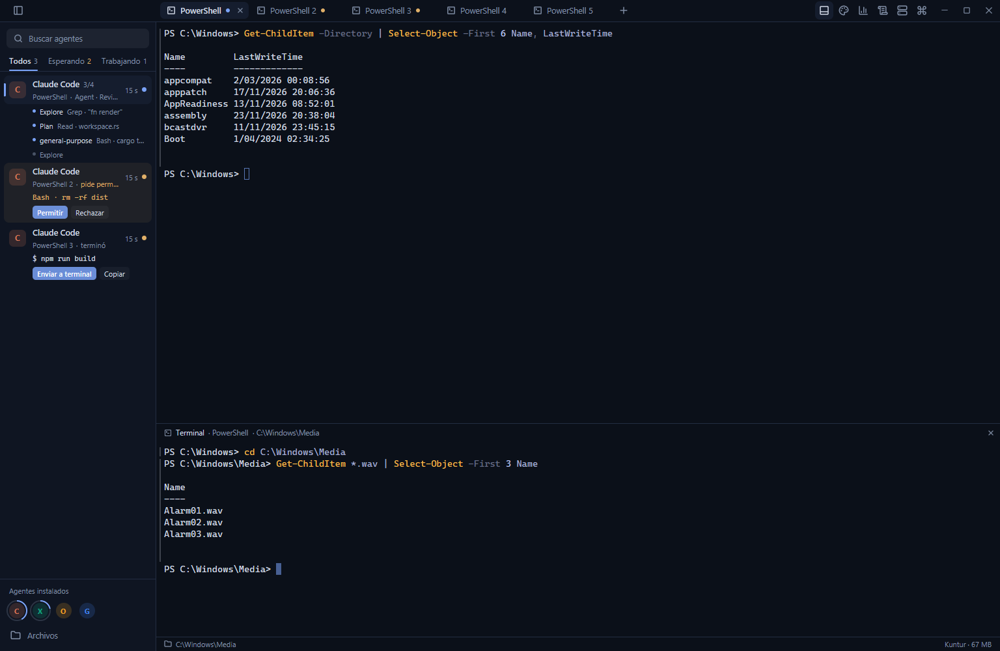
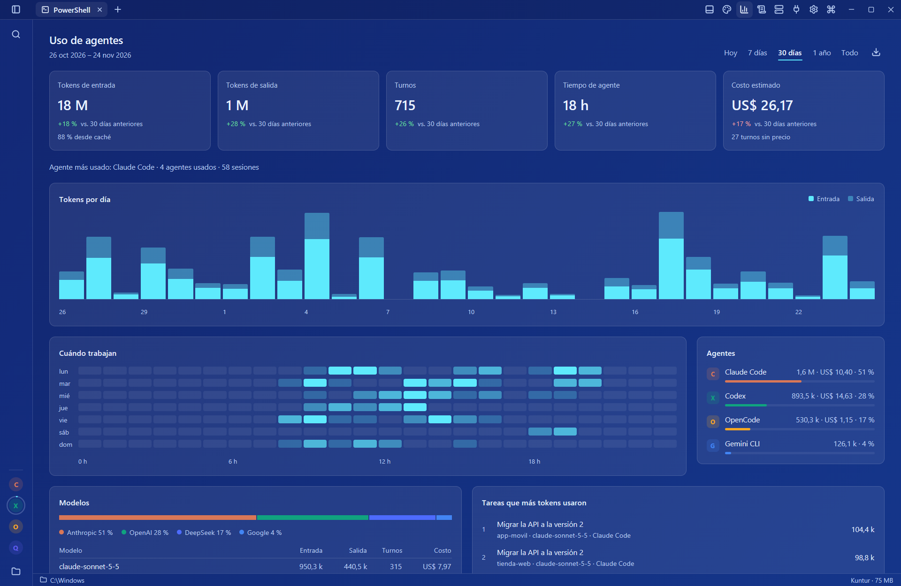
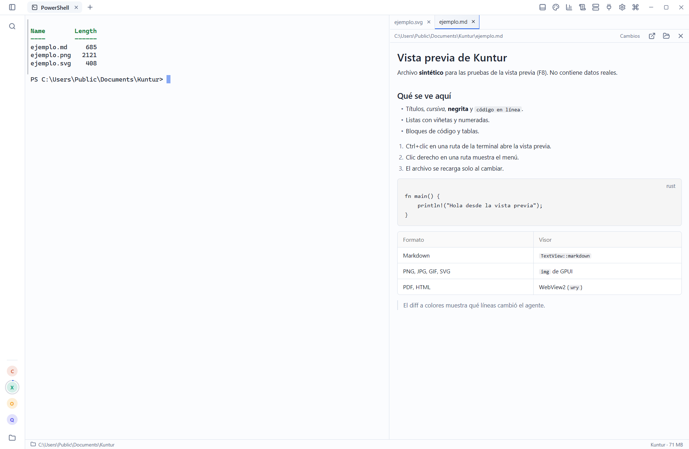

# Kuntur Terminal IA Agente

**English** · [Español](README.es.md)

> **Status: early preview (0.1).** Usable day to day on Windows 11, but expect rough edges. Feedback is welcome.

**Kuntur Terminal IA Agente** — *Kuntur* means *condor* in Quechua — is a lightweight terminal for Windows, written in Rust, built for working with
AI coding agents on the command line (Claude Code, Codex, OpenCode, Qwen, Gemini…). Like a condor seeing the whole
valley from above, you see every session at a glance and what each agent is doing right now.



- **Light:** about **60–80 MB of RAM** with one window, under **120 MB** with five sessions and several agents
  (Warp uses ~900 MB on the same machine). Native GPU rendering through [GPUI](https://www.gpui.rs/).
- **Private by design:** everything runs locally. No account, no telemetry, no network calls of its own.

## Features

- **Real terminal:** ConPTY + `alacritty_terminal` (colors, truecolor, mouse, alternate screen, bracketed paste,
  OSC 52 clipboard); smart Ctrl+C (copies when there is a selection), Ctrl+V, right-click paste.
- **Sessions as tabs**, saved and restored; side panel full or icons-only; three themes (**Blue**, **Dark**,
  **White**) from `themes/*.toml`; command palette (Ctrl+Shift+P).
- **Agents panel:** running agents and sub-agents in a compact tree with their current action and exact state
  (working / asking for permission / waiting for you / done) through Claude Code hooks (`kuntur-hook.exe`, a named
  pipe and OSC 7501). Allow or deny from the row, a git worktree per agent, "Send to terminal" for suggested commands.
- **Docked terminal** (Ctrl+`) under each session, in the session's folder or the agent's worktree.
- **Alerts:** a badge on the tab and a Windows notification when an agent in a hidden tab finishes or needs you.
- **Agent usage:** tokens per day, hour heat map, models, top tasks and an **estimated cost**
  (editable `pricing.toml`), for Today / 7 days / 30 days / 1 year / All, with CSV export. Read incrementally from
  the agents' own local logs into a local SQLite store.
- **Audit:** every command an agent ran (date, session, agent, host, command), with search, filters and CSV.
- **SSH and SFTP** (`russh`): saved connections, `known_hosts` check, the Windows ssh-agent, passwords only in the
  Windows Credential Manager; remote tabs with a docked channel on the same connection; remote file tree with
  upload (drag and drop from Explorer), download and a transfer queue. Local and remote are never mixed.
- **Preview and diff:** paths and URLs in the output are clickable; Markdown, images, SVG, colored diffs, PDF and
  HTML (WebView2) in a split view that reloads on change.
- **Shell integration:** OSC 133 blocks (a thin mark per command, red on error) and **ghost-text completion** for
  paths, folder memory and per-folder history (Tab or → accepts).

| Usage (Blue) | Preview and diff (White) |
|---|---|
|  |  |

## Install

Download `kuntur-<version>-x86_64.msi` from the project's Releases page and run it. It installs `kuntur.exe` and
`kuntur-hook.exe` in `C:\Program Files\Kuntur` and adds **Kuntur** to the Start menu. Uninstall from *Settings →
Apps*; your settings in `%APPDATA%\Kuntur` are kept.

Requirements: Windows 11 x64 (tested; Windows 10 1809+ should work, since it has ConPTY), a GPU with DirectX 11/12. Recommended font: Cascadia Mono
(ships with Windows 11). The PDF/HTML preview uses the WebView2 runtime that comes with Windows.

## Build from source

Requirements: Rust stable (1.90+) and Visual Studio Build Tools with "Desktop development with C++" (MSVC +
Windows SDK).

```powershell
git clone https://github.com/jrsprescott/kuntur.git
cd kuntur
cargo build -p kuntur-app -p kuntur-hook --release
.\target\release\kuntur.exe
```

The first build takes several minutes (GPUI and SQLite). To build the MSI you also need WiX Toolset v3.14 and
`cargo install cargo-wix`; then run `.\scripts\msi.ps1` (see [CONTRIBUTING.md](CONTRIBUTING.md)).

## Keyboard shortcuts

| Shortcut | Action |
|---|---|
| Ctrl+Shift+P | Command palette (themes, sessions, actions) |
| Ctrl+Shift+T / Ctrl+Shift+W | New session / close session |
| Ctrl+Tab, Ctrl+Shift+Tab, Ctrl+1…9 | Switch sessions |
| Ctrl+Shift+B | Side panel: full ↔ icons |
| Ctrl+Shift+E | Files panel (local or remote, per tab) |
| Ctrl+` (Ctrl+Ñ on Spanish keyboards) | Show/hide the docked terminal |
| Ctrl+Shift+U | Agent usage (← → period, Ctrl+S export CSV) |
| Ctrl+Shift+A | Audit (type to search, ← → period, ↑ ↓ agent, Ctrl+S export CSV) |
| Ctrl+Shift+O | SSH connections (↑ ↓ select, Enter connect, F2 edit, Del delete, Ctrl+N new) |
| Ctrl+Shift+R | Reconnect a remote tab |
| Ctrl+= / Ctrl+− / Ctrl+0 | Font size |
| Ctrl+click / right-click on a link | Open / link menu |
| Tab or → | Accept the ghost-text suggestion |
| Esc | Closes whatever is on top (palette, panel, menu); otherwise goes to the shell |

## Privacy

- Kuntur makes **no network connections of its own** and has **no telemetry**. The only connections are the SSH
  sessions you open and whatever the programs you run inside the terminal do (an HTML file you preview may load
  what it references, as in any browser; links open in your default browser).
- Usage, costs and audit are computed **locally** from the agents' log files on your disk; nothing leaves your PC.
- SSH passwords are stored only in the Windows Credential Manager, and only if you tick "remember".
- Claude Code hooks are installed only after you confirm, and only add entries pointing to `kuntur-hook.exe`.

## Accessibility

Every panel can be driven from the keyboard, Esc behaves the same everywhere, font size is adjustable and all three
themes meet WCAG AA contrast (checked by a test). Screen readers are **not** supported yet: GPUI does not expose
an accessibility tree (UI Automation) on Windows.

## Contributing and security

See [CONTRIBUTING.md](CONTRIBUTING.md) and [SECURITY.md](SECURITY.md). Changes are listed in
[CHANGELOG.md](CHANGELOG.md). Project docs (in Spanish) live in [`docs/`](docs/), starting with
[`docs/plans/README.md`](docs/plans/README.md).

## License

Licensed under either of [Apache License, Version 2.0](LICENSE-APACHE) or [MIT license](LICENSE-MIT) at your option.
Unless you explicitly state otherwise, any contribution intentionally submitted for inclusion in Kuntur by you, as
defined in the Apache-2.0 license, shall be dual licensed as above, without any additional terms or conditions.
